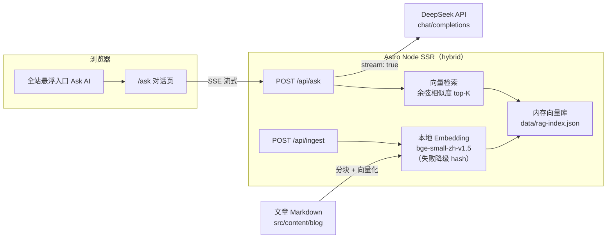

# 小小博客 · xiaoxiao-blog

一个基于 **Astro 7** 的个人博客 + 在线工具站，内置一个旗舰功能——**RAG 博客问答助手**（检索增强生成）。

> **简历关键词**：RAG、向量化 Embedding、余弦相似度检索、大模型流式生成（SSE）、混合渲染（hybrid SSR）、Prompt 工程、Node 部署。

## ✨ 功能

### 博客
- Markdown / MDX 内容集合，支持 RSS 与 sitemap
- 文章按年份归档、响应式暗色风格、滚动动效

### 在线工具（纯前端）
- JSON 格式化（本地处理，不上传）
- B站关注时间（调公开接口）
- 程序员人格测试
- Website Speed Lab（浏览器 Navigation Timing 可视化）
- 站点性能记录：每日采集本站移动端 Lighthouse 实验室指标，展示历史趋势与失败状态

### AI：RAG 问答助手（旗舰功能）
- 基于**本站文章**的检索增强问答，回答附**引用来源**
- **本地 embedding**：`Xenova/bge-small-zh-v1.5`（512 维中文向量，CPU 运行，零额外 API 成本）
- **DeepSeek 流式生成**：逐字输出（SSE），体验接近主流 AI 产品
- 结构感知分块 + 余弦相似度 top-K 检索
- 可插拔 embedding 后端 + 离线降级（hash 向量），无网络也能跑通全流程
- 内容指纹自动感知文章增删改，索引自动重建

## 🏗 架构



**RAG 管线**：文章 Markdown → 结构感知分块 → 本地 embedding → 内存向量库。提问时：问题向量化 → 余弦相似度 top-K 检索 → 拼接上下文 + 提示词 → DeepSeek 流式生成 → 附引用返回。

## 🧱 技术栈

| 层 | 技术 |
| --- | --- |
| 框架 | Astro 7（hybrid 渲染）+ TypeScript |
| SSR 适配器 | `@astrojs/node`（standalone） |
| 向量化 | `@huggingface/transformers` + `Xenova/bge-small-zh-v1.5` |
| 生成 | DeepSeek API（`deepseek-chat`，流式） |
| 前端渲染 | `marked` + `DOMPurify`（Markdown 渲染与消毒） |
| 部署 | Ubuntu + PM2 + Nginx |

## 🚀 快速开始

要求 Node ≥ 22.12。

```bash
npm install
cp .env.example .env   # 填入 DEEPSEEK_API_KEY
npm run dev            # http://localhost:4321
```

打开 `/ask` 即可体验问答。**没有 API Key 也能跑通界面**（会用 hash 向量降级，生成阶段会提示缺少 Key）。

> 首次使用本地 embedding 会从 HuggingFace 下载模型（约几十 MB）。想跳过下载、纯离线调试，把 `.env` 里的 `EMBEDDING_PROVIDER` 改成 `hash`。

## ⚙️ 配置

所有配置通过环境变量（根目录 `.env`）注入，详见 [`.env.example`](./.env.example)：

| 变量 | 必填 | 说明 |
| --- | --- | --- |
| `DEEPSEEK_API_KEY` | 是 | DeepSeek API Key |
| `DEEPSEEK_API_BASE` | 否 | 接口地址，默认 `https://api.deepseek.com` |
| `DEEPSEEK_MODEL` | 否 | 模型名，默认 `deepseek-chat` |
| `EMBEDDING_PROVIDER` | 否 | `local`（默认）/ `hash` |
| `DATA_DIR` | 否 | 索引缓存目录，默认 `./data` |

## 📡 API

### `POST /api/ask`
请求：

```json
{ "question": "这个博客的 RAG 是怎么实现的？", "history": [] }
```

响应为 SSE 流（`text/event-stream`），事件类型：

- `sources`：检索到的引用来源（文章标题 / slug / 章节）
- `delta`：增量文本
- `done`：结束
- `error`：错误信息

### `POST /api/ingest`
强制重建 RAG 索引（预下载模型 + 重新向量化），返回 `{ ok, chunks, model, elapsedMs }`。部署后预热一次、新增文章后刷新都用它。

## 📁 目录结构

```text
src/
├── content/blog/         # 文章（RAG 语料来源）
├── lib/                  # RAG 核心
│   ├── chunker.ts        #   分块策略
│   ├── embedding.ts      #   embedding 后端（本地 + 降级）
│   ├── vector.ts         #   余弦相似度 + top-K
│   ├── knowledge.ts      #   索引构建 / 缓存 / 检索
│   ├── deepseek.ts       #   DeepSeek 流式客户端
│   └── rag.ts            #   提示词 + 回答编排
├── pages/
│   ├── api/ask.ts        #   SSE 问答接口
│   ├── api/ingest.ts     #   重建索引接口
│   └── ask.astro         #   对话页
├── scripts/ask.ts        #   前端聊天逻辑（流式渲染 + 引用）
└── ...
docs/
├── architecture.md       # 架构与设计决策
└── deployment.md         # Ubuntu + PM2 + Nginx 部署
deploy/
├── ecosystem.config.cjs  # PM2 配置
├── nginx.conf            # Nginx 反代配置
├── setup-server.sh       # 首次部署
└── update.sh             # 日常更新发布
```

## 📚 更多文档

- [架构与设计决策](./docs/architecture.md)
- [部署指南（服务器落地）](./docs/deployment.md)

## 📈 站点性能记录

`npm run monitor` 调用 PageSpeed Insights API 测量固定的本站首页，将移动端 Lighthouse 分数、LCP、CLS、TBT、FCP 写入 `src/data/performance-history.json`。缺失指标保留为空，失败采样单独记录；同一天重试会替换旧记录，最多保存 90 次。可选环境变量 `PAGESPEED_API_KEY` 用于提高调用额度，不应写入仓库。

GitHub Actions 的 `performance-monitor.yml` 每日运行，也支持手动触发。它会测试、构建并将历史记录提交到默认分支；服务器仍需再次运行 `bash deploy/update.sh` 才会显示新数据。首次采样前 `/performance` 会显示空状态。

这些是实验室模拟数据，不是访客真实体验数据。TBT 不能当作 INP。`/tools/speed-lab` 的跨域浏览器探测缺少完整页面阶段时不会给整站打分。

## Credit

主题基于 [Bear Blog](https://github.com/HermanMartinus/bearblog/) 的设计语言，感谢 Astro 与 HuggingFace 生态。
