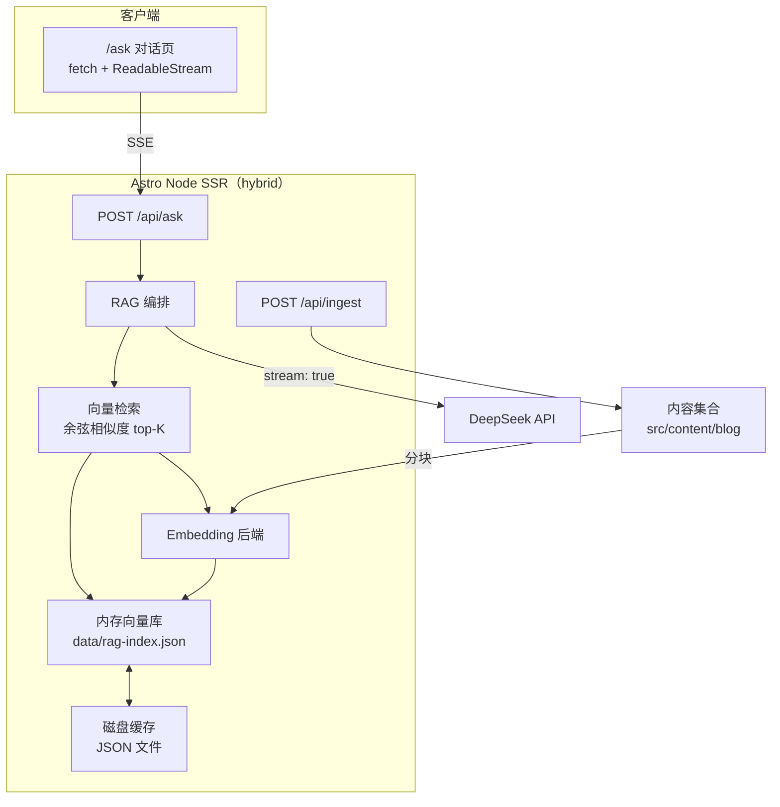
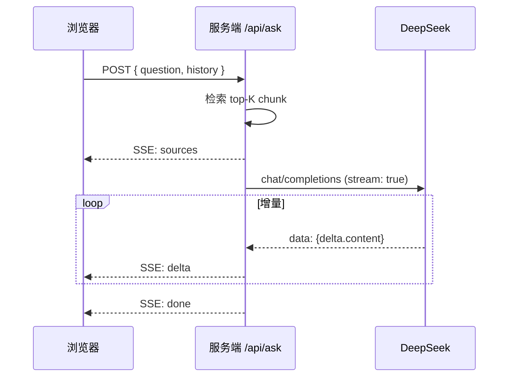

# 架构与设计决策

本文档说明 RAG 博客问答助手的技术架构，以及每个环节「为什么这么选」。

## 总览



## 为什么是 hybrid 渲染

博客主体是内容型页面，静态预渲染能保住「构建即优化、Nginx 直接吐 HTML」的性能；而 RAG 的接口必须跑在服务端（读 Key、跑模型、调大模型）。Astro 的 `hybrid` 模式让两者共存：

- 博客 / 工具页：**默认预渲染**（静态 HTML）；
- `/api/*` 端点：**服务端渲染**；
- `/ask` 页：本身也是静态 HTML，交互全靠客户端请求 `/api/ask`。

## Embedding 后端：本地模型 + 可插拔

DeepSeek 官方目前只提供对话补全，不提供 embedding 接口，因此向量化在本地完成。

```ts
export interface Embedder {
  readonly name: string;
  readonly dim: number;
  embed(texts: string[]): Promise<number[][]>;
}
```

两个实现：

| 实现 | 说明 | 适用 |
| --- | --- | --- |
| `LocalEmbedder` | `@huggingface/transformers` + `Xenova/bge-small-zh-v1.5`（512 维，mean pooling + L2 归一化） | 生产 |
| `HashEmbedder` | 字符 n-gram 哈希，确定性向量 | 离线调试 / 降级 |

`getEmbedder()` 优先加载本地模型，失败自动降级到 hash，保证「没有网络也能跑通全流程」。

### 为什么 external 掉 transformers.js

Transformers.js 在运行时动态读取 `node_modules` 里的 ONNX 模型文件。若被 Vite 打包内联，模型路径会失效，所以：

```js
vite: { ssr: { external: ['@huggingface/transformers'] } }
```

## 分块策略

1. 按 Markdown 标题（`#`~`######`）切章节；
2. 章节内按句子合并成约 **480 字符**窗口；
3. 相邻窗口保留 **80 字符**重叠；
4. 每个 chunk 前缀带「文章标题 + 章节标题」。

> 选择 480 字符：块太大语义稀释、检索精度下降；块太小上下文不完整。重叠避免关键句被从中间切断。

## 向量存储：内存数组 + JSON 缓存

博客量级（几十~几百 chunk）用内存数组线性扫描 + 余弦相似度即可，单次检索毫秒级。不引入向量数据库，属于「量级匹配的克制」。

- 构建产物缓存到 `data/rag-index.json`；
- 缓存里存**内容指纹**（所有文章 id + body 的 SHA-1）；
- 加载时比对指纹，文章有增删改则自动重建；
- `POST /api/ingest` 强制重建（部署预热、新增文章刷新）。

## 流式生成链路



服务端把 DeepSeek 的 SSE 转成自有事件协议（`sources` / `delta` / `done` / `error`），前端不感知 DeepSeek 细节，接口也更易扩展。

解析 SSE 的两个关键点：

1. `TextDecoder.decode(value, { stream: true })` 处理多字节字符（中文）被 TCP 分片截断的问题；
2. 维护缓冲区按 `\n` 切行、按空行切事件，避免粘包。

## 提示词设计

系统提示词的五条硬规则（只依据资料、绝不编造、带 [n] 引用、先结论后展开、无关问题礼貌拒绝）是为了压制 RAG 最常见的「无视资料、自由发挥」问题。检索片段编号后拼进用户消息，引导模型顺引用组织答案。

## 安全

- API Key 只在服务端（`.env`），前端永不暴露；
- 前端渲染模型输出前经过 `DOMPurify` 消毒，防 XSS；
- 引用链接为站内相对路径，来源可控；
- 站内 `/api/*` 为**无鉴权公开接口**（不依赖 Cookie 会话），已关闭 Astro 的 CSRF `checkOrigin`：因为 standalone 模式不解析 `X-Forwarded-Proto`，HTTPS 反代后 Astro 会把 origin 误判成 `http://`，导致同源 POST 被 403。接口公开是本项目的定位，鉴权与限流留作后续增强。

## 局限与改进方向

- 向量检索目前是单路召回，可加 BM25 混合检索 / 重排序（rerank）提精度；
- chunk 固定长度，可改成按语义分段；
- 索引是内存态，重启后首次请求会从磁盘懒加载；量级再大可换 SQLite / 向量库。
